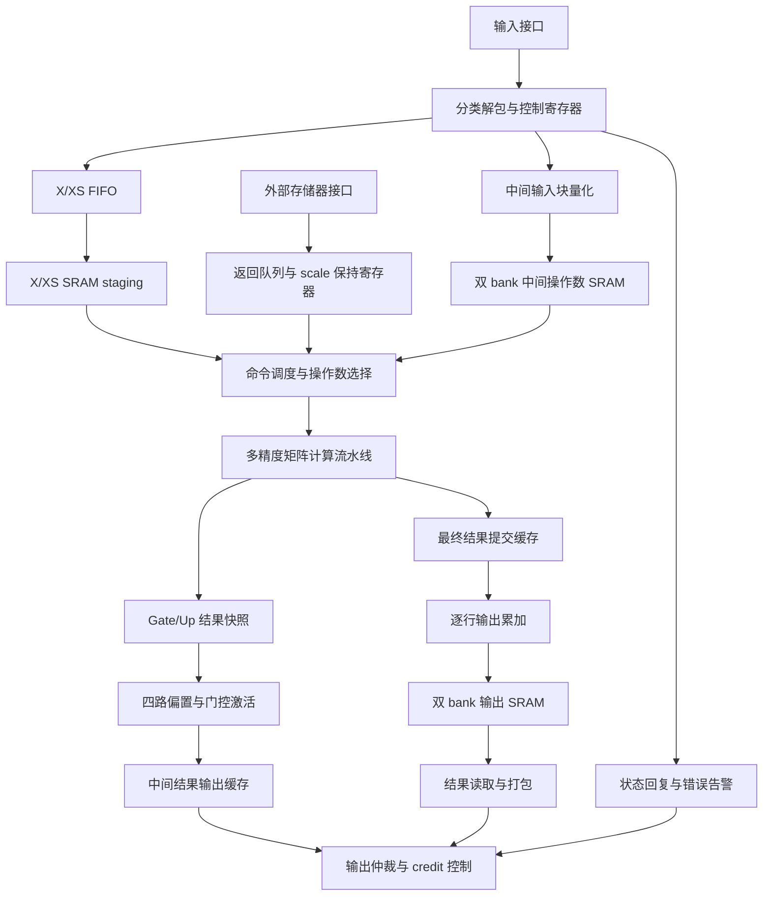

# 多精度Tensor Core

## 1. 文档边界定位：

- 当前存储阵列为行为级 SRAM/ROM 模型，尚不能等同于已绑定的物理存储宏。
- 本文的周期定义来自 RTL 寄存器和握手结构；未将周期模型的估计值当作实测性能。
- 1 GHz 是设计目标，不是当前实现已实现的签核频率。

## 2. 总体功能与固定配置

多精度Tensor Core 将低精度矩阵点积、FP32 累加、门控非线性运算和输出量化组织为一个可调度的计算单元。

| 参数 | 当前实现 |
|---|---|
| 并行 token 数 | 最多 4，分别对应 4 个 lane |
| 点积归约长度 | 每个事务 K=32 |
| 权重输入宽度 | 1024 bit/计算事务 |
| 激活输入宽度 | 4×32×8=1024 bit/计算事务 |
| 激活格式 | FP8 E4M3，每 token、每 32 元素配一个 UE8M0 scale |
| 最大并行输出列数 | 8，随权重格式变化 |
| 内部累加格式 | FP32 |
| 第一类矩阵阶段 | K=5120，72 输出列：36 gate 列和 36 up 列 |
| 第二类矩阵阶段 | K=2304，80 输出列 |
| 结果 token slot | 每个输出 bank 64 个 |
| 输出 bank 数 | 2 |
| 时钟与复位 | 单时钟；同步低有效复位 |

上述尺寸是当前实现配置，不表示可在运行时任意改变矩阵尺寸。

## 3. 内部结构



图中的路径是不同任务阶段，不是一条统一固定延迟的流水线。中间结果输出与后续中间输入之间不存在本单元内部的自动回送路径。

## 4. 对外边界接口

### 4.1 顶层信号

| 信号 | 方向 | 位宽 | 语义 |
|---|---|---:|---|
| clk | 输入 | 1 | 所有时序逻辑的工作时钟 |
| rst_n | 输入 | 1 | 上升沿采样；低有效复位 |
| dn_valid | 输入 | 1 | 当前输入 flit 有效 |
| dn_payload | 输入 | 512 | 输入数据或命令内容 |
| dn_sideband | 输入 | 32 | 类型、标识及索引等元数据 |
| up_valid | 输出 | 1 | 输出 beat 有效 |
| up_payload | 输出 | 128 | 输出数据 |
| up_sideband | 输出 | 24 | 输出类型、标识、包尾等元数据 |
| up_credit | 输入 | 2 | 返回的输出 credit 数，不是 ready 信号 |
| sync0 | 输出 | 1 | X/XS FIFO 成功消费一项的通知 |
| sync1 | 输出 | 1 | 阶段完成通知，不等同于所有输出已排空 |
| err_line | 输出 | 1 | 存在未屏蔽 sticky error |
| sim_load | 输入 | 1 | 仿真镜像加载使能，不是正式计算数据口 |
| sim_addr | 输入 | 21 | 仿真镜像的字地址 |
| sim_data | 输入 | 1024 | 仿真镜像写入数据 |

输入接口没有逐拍 ready 反压。输入方必须遵守容量及顺序契约；超量或非法输入可能触发错误，不能假定所有输入都会被缓存。

### 4.2 外部存储器的内部适配边界

当前仿真顶层包含存储模型，正式读请求并未作为独立顶层管脚导出。适配层与调度器之间使用以下接口语义：

| 接口组 | 位宽 | 契约 |
|---|---:|---|
| 请求有效/请求就绪 | 各 1 | 同时为 1 时采样一个请求 |
| 字地址 | 21 | 每字 1024 bit；合法容量由实例参数限制 |
| 返回有效 | 1 | 指示固定时延返回数据 |
| 返回数据 | 1024 | 权重字或 scale 字 |

返回通路不能被反压，因此发起请求之前必须保留接收空间。在途请求信用预算为 3，返回队列深度为 4；二者分别限制传输在途量与未消费返回量，不是同一个计数器。

### 4.3 关键数据通路宽度

| 数据通路 | 数据量/有效拍 | 限制因素 |
|---|---:|---|
| 输入数据口 | 64 Byte | 所有输入类型共享 |
| 外部存储器返回 | 128 Byte | 请求信用、返回队列、计算反压 |
| staging 至计算阵列 | 128 Byte 激活 + 4 Byte scale | SRAM 返回与操作数就绪 |
| 权重至计算阵列 | 128 Byte 权重 + 最多 32 Byte scale | 格式和有效列数 |
| 计算结果 | 最多 128 Byte FP32 | 4 token×8 列；仅 mask 指定位置有效 |
| 中间量化输入 | 64 Byte BF16 | 单 token 的 32 元素块 |
| 中间量化输出 | 32 Byte FP8 + 1 Byte scale | 每有效量化事务 |
| 单个输出 SRAM 行 | 32 Byte FP32 | 每行 8 列 |
| 输出数据口 | 16 Byte | 仲裁、包锁定、credit |

这些是接口容量，不是持续业务吞吐。以 1 GHz 举例，64 Byte/cycle 对应 64 GB/s，128 Byte/cycle 对应 128 GB/s；并非 64 或 128 Byte/s。内部 128 Byte 激活读取来自 4 路已缓存操作数，不要求输入口每周期接收 128 Byte。

## 5. 权重格式与矩阵计算粒度

| 格式编码 | 权重配置 | 每权重位数 | 每字输出列数 | weight scale |
|---:|---|---:|---:|---|
| 0 | FP4 | 4 | 8 | UE8M0，每 32 K |
| 1 | FP8 | 8 | 4 | UE8M0，每 32 K |
| 2 | FP8-F32 | 8 | 4 | FP32，每 128 K |
| 3 | FP8-BF16 | 8 | 4 | BF16，每 128 K |
| 4 | INT4 | 4 | 8 | BF16，每 32 K |
| 5 | BF16 | 16 | 2 | 无独立 weight scale |

FP4 解码的非负幅值为 0、0.5、1、1.5、2、3、4、6，另有符号位。INT4 按四位有符号整数解码。FP8 使用 E4M3 编码。

权重在字内按 `column×32+k` 排列；同一列权重跨 4 个 token 共享。一次 FP4 事务计算：

```text
[4,32] activation × [32,8] weight → [4,8] partial sums
```

FP8 和 BF16 分别变为 `[4,4]`、`[4,2]` 输出。无效 token/列不更新目的累加元素。

结构上具有 8 列×4 token 的逻辑 dot32 单元，其中前 2 列×4 token 支持 BF16 宽范围路径，其余 24 个单元使用低精度归约路径。

若每拍接收独立满载事务，FP4/INT4、FP8、BF16 分别对应 1024、512、256 MAC/事务；乘和加分别计一次 operation 时为 2048、1024、512 operation/事务。这只是阵列上限，不能据此宣称本单元持续算力。

## 6. 精确归约、缩放与累加

### 6.1 dot32 数值路径

1. 解码符号、有效数与指数，特殊值单独携带标记。
2. 有效数相乘，生成精确乘积。
3. 将乘积对齐到共同定点基准。
4. 使用 carry-save 压缩树归约 32 项，减少中间进位传播。
5. 完成最终进位加法、符号处理、前导位检测与规格化。
6. 最终精确和只进行一次 round-to-nearest-even，形成 FP32 partial。

低精度路径使用 42-bit 有符号定点数，量化单位为 2^-18；BF16 路径使用 285-bit 有符号定点数，量化单位为 2^-142。宽度用于保留完整指数跨度及相消后的低位余量，不代表使用 285-bit 浮点输出。

不允许先把若干子组舍入为 FP32 再相加来替代精确 dot32。面积优化采用压缩树、分段进位和专用舍入器，而不是静默截断有效位。

### 6.2 scale 与 FP32 累加

UE8M0 scale 通过指数调整实现。对于 BF16/FP32 weight scale，保持先应用 activation scale 并舍入、再乘 weight scale 并舍入的顺序，不融合成一次舍入。

RF 保存 80 列×4 token 的 FP32 累加值。首块直接初始化目的元素；后续 K-block 按接收顺序累加。末块标志随事务传递，不能用当时已变化的输入配置解释在途数据。

同一 RF 元素有未提交更新时，新事务通过 in_ready 反压等待。首块覆盖写也遵守此规则。独立目的元素可以流水接收，但地址资源总量有限。

### 6.3 特殊值

- 保留 subnormal，不采用默认 flush-to-zero。
- FP32 舍入采用 RNE，覆盖上溢、下溢、有符号零、NaN 和无穷。
- 保留 E4M3 非法编码替代与错误上报机制；不能把替代数据当作无错误输入。
- 非法描述符不应写 RF；数值错误与协议错误分开记录。
- 禁止用浮点容差替代逐位验收。

## 7. 流水线与时钟沿契约

本文 E0 是输入被上升沿采样的时刻；“E1 沿后返回”指 E1 非阻塞赋值完成后可见，同步下游最早在 E2 上升沿消费。

| 路径 | 当前结构/时序 |
|---|---|
| staging SRAM | E0 接收 → E1 沿后返回 → E2 下游采样 |
| 中间操作数 SRAM | 数据 SRAM 同上；还需满足 bank 所有权与完整性 fence |
| 外部存储器模型 | E0 接收 → E2 沿后返回 → E3 下游采样 |
| 独立 FP32 乘法器 | 4 个寄存阶段，E0 接收至 E3 沿后输出 |
| 32 元素量化 | E0 捕获数据/最大值 → E1 编码与 scale → E2 对齐 → E3 输出 |
| 门控激活 | E0 接收至 E23 沿后输出；支持连续列对 |
| 矩阵计算核心 | 36 个寄存级，E0 接收至 E35 提交 |
| 输出累加及读取 | 多阶段状态机；受行数、有效 lane、端口冲突及输出反压影响 |

矩阵核心的 36 级划分为：

```text
输入/解码 2 级 → 精确 dot32 13 级 → scale 13 级 → RF 读取/加法/提交 8 级
```

门控激活的主要沿位置为：输入 E0；偏置加法 E1～E7；边界转换与 clamp E8；查表索引/返回 E9～E10；三级串联乘法 E11～E22；BF16 输出 E23。

固定流水延迟不包含输入等待。SRAM 返回、计算握手、结果捕获、状态机启动之间还可能存在寄存器边界，不能直接将模块延迟相加当作整阶段执行时间。

## 8. 操作数缓存与权重流

### 8.1 X/XS 接收与 staging

X 和 XS 共用一个 128 项 FIFO，每项 534 bit，包括 512-bit 数据及类型、pass、lane、索引元数据。FIFO 成功弹出时产生 sync0；空 FIFO 的无效 pop 不返还信用。

X staging 和 XS staging 分别为 2 bank×4 token×64 Byte，总共 1024 Byte。两类数据分别保存激活值和块 scale，不能将 XS 当作第二组激活。

一个 X flit 保存单 token 的 64 个 FP8，覆盖相邻两个 K=32 块。一个 XS flit 保存单 token 的 64 个 UE8M0 scale，覆盖 64 个 K-block。

K=5120 时，每 token 需要 80 个 X flit 和 3 个 XS flit。输入次序按 scale 分组：先送该组各 token 的 XS，再按 X 索引送各 token 的数据。最后一个 scale 分组只覆盖剩余 K-block。

双 bank 是有限容量循环缓存，不是保存整个输入向量的 SRAM。控制器必须在旧数据已被取走后允许覆盖，并检查 pass、lane 和索引次序。

### 8.2 权重与 scale 顺序

外部存储器字宽 1024 bit，按 K-block 优先组织：需要更新 scale 时先取 scale 字，再依次取各列组权重字。

FP8-F32/FP8-BF16 的 scale 每 4 个 K-block 更新一次，其余带 scale 的配置每块更新；BF16 权重不额外读取 scale。每个命令 slot 配有 80×32-bit scale 保持寄存器。

GU 阶段 72 列，D 阶段 80 列。以 FP4 为例，不计可选 bias：GU 为 160×(1 scale 字+9 权重字)=1600 字；D 为 72×(1 scale 字+10 权重字)=792 字。此处统计的是当前镜像布局的访问量，不是周期数。

## 9. 门控后处理与中间量化

### 9.1 GU 快照与门控激活

GU 最终结果保存为 72×4 FP32 快照。每个列对提供 gate 和 up 值，四个 token lane 并行处理：

```text
g0 = FP32_RNE(g + gate_bias)
u0 = FP32_RNE(u + up_bias)
g1 = BF16_RNE(g0)，再无损扩展回 FP32
u1 = BF16_RNE(u0)，再无损扩展回 FP32
g2 = min(g1, +10)
u2 = clamp(u1, -10, +10)
s  = sigmoid_lookup(g2 的 BF16 编码)
m1 = FP32_RNE(g2 × s)
m2 = FP32_RNE(m1 × u2)
h  = BF16_RNE(FP32_RNE(token_weight × m2))
```

偏置关闭时仍执行加 +0 的步骤；不可任意用旁路替代而改变有符号零语义。当前不支持可编程 softclip 等任意非线性配置。

Sigmoid 使用 BF16 编码索引的 FP32 ROM，每 lane 一份 65536×32-bit 表。表内容按冻结的数值生成规则使用，不将理想实数 sigmoid 与该离散实现混为一谈。

本地中间输出共有 36×4 个 BF16，最大 288 Byte，写入独立输出缓存后按 128-bit beat 打包。

### 9.2 中间输入量化与双 bank 缓存

每个量化事务处理单 token 的 32 个 BF16：平衡树计算绝对值最大值，应用 1e-4 下限，选择共享指数，再输出 32 个 E4M3 与一个 UE8M0 scale。

指数选择按规格化最大值的尾数阈值 0.75 分段；scale 编码范围为 105～247。采用 RNE，有限量化值限制到 ±448。含非有限值的块使用 scale=247，无穷映射到对应符号的饱和值，NaN 映射到零，同时报告数值错误。

数据、scale、tag、非有限标记与 valid 同步推进，避免连续 A/B/C 事务相互串位。

中间 SRAM 每 bank 为 72 行×1024 bit，一行含 4 个 token 的 32 元素块。按 lane 使用字节使能写入；每行另存四个 scale。只有 bank 已归属当前任务且所有预期 lane 的 72 行均写完，才允许 D 阶段使用。重复写、越界行、非法 lane 或无所有权写入须拒绝。

## 10. 最终结果累加与输出读取

### 10.1 提交缓存与数值语义

D 阶段最终 80×4 FP32 先进入提交缓存，随后以每行 8 列、每次一个 token lane 执行读改写：

```text
wb = FP32_RNE(token_weight × BF16_bias)
v  = FP32_RNE(d + wb)
t  = BF16_RNE(v)，再无损扩展回 FP32
y  = FP32_RNE((slot_valid ? old_y : +0.0) + t)
```

偏置仅在规定的首阶段条件满足时启用，否则使用 +0。这里不会再次把整个 d 乘 token_weight，不能将其错误解释为 token_weight×(d+bias)。

提交前锁存 bank、slot、mask、权重和偏置，整个提交期间保持归属。下一次结果装载必须避免覆盖仍被使用的提交缓存。

### 10.2 输出 bank 与 DRAIN

两个输出 bank 各有 64 个 token slot；每 slot 80 个 FP32，即 10 行，每行 8 列。valid 位指示 slot 是否已有有效累加结果。

新 slot 用 +0 作为累加左操作数，已有 slot 读出旧值后相加。一个 lane 的最后一行提交后发布有效位。

DRAIN 接收 bank、slot、列起点、列数、segment 与最后段标志，读取输出 SRAM，将 FP32 转为 BF16，每 beat 最多 8 个结果。完整 80 列产生 10 个 beat。

输出 credit 不足时保持待发数据，不能重复消费。最后一段发送完成后释放 slot 有效位。对无效 slot 读取走零结果路径并报告相应错误，而不是读取未初始化 SRAM。

提交与 DRAIN 共享读资源，同 bank 提交读取具有优先权；冲突等待通过计数事件记录。该路径是可变时长状态机，不能只用浮点流水级数代替完成时间。

## 11. 存储资源清单

以下为逻辑数据容量，不含地址寄存器、有效位、指针、流水寄存器与布线，也不是物理面积。

| 资源 | 组织 | 数据容量 |
|---|---|---:|
| X/XS FIFO | 128×534 bit | 8544 Byte |
| X staging | 2×4×64 Byte | 512 Byte |
| XS staging | 2×4×64 Byte | 512 Byte |
| 中间数据 SRAM | 2×72×1024 bit | 18432 Byte |
| 中间 scale | 2×72×4×8 bit | 576 Byte |
| 输出 SRAM | 2×640×256 bit | 40960 Byte |
| D 提交缓存 | 80×4×32 bit | 1280 Byte |
| GU 快照 | 72×4×32 bit | 1152 Byte |
| 中间输出缓存 | 144×16 bit | 288 Byte |
| 计算 RF | 80×4×32 bit | 1280 Byte |
| weight scale 保持 | 2×80×32 bit | 640 Byte |
| Sigmoid ROM | 4×65536×32 bit | 1024 KiB |

外部存储器镜像模型的容量可配置，不计入本单元固定片内缓存容量。ROM 多副本是实现选择，不能在未分析端口和吞吐前直接假设可以合并为一个单端口宏。

## 12. 调度、顺序和资源生命周期

- 两个命令 slot 保存当前与候选任务；同一时刻一个阶段占用矩阵计算资源。
- 请求发起受操作数就绪、外部存储器信用、返回队列空间约束。
- 计算接收受 in_valid/in_ready 约束；受阻时数据与元数据必须保持稳定。
- 结果捕获队列关联已接收事务与对应阶段，避免输出返回时使用错误的 slot 配置。
- GU 快照与中间输出缓存是有限占用资源；未输出完成不能任意覆盖。
- D 阶段必须等待中间 bank 完整，使用结束后释放所有权。
- 提交与输出读取可与其他计算重叠，但不能破坏 bank、slot 和缓存生命周期。
- 阶段完成不要求控制状态机一定回到某个空闲编码；最终排空必须检查真实在途资源。

排空条件至少包含：两个命令 slot 无效、请求/捕获队列为空、计算核心空闲、无待启动 ACT/提交、输出累加与 DRAIN 空闲、无包锁定、无待发数据或状态回复。所有判断需四态安全，未知值不能当作空闲。

命令迁移、scale 归属及重叠调度仍需专项验证；上述规则是实现必须满足的约束，不表示所有交叠组合已经验证通过。

## 13. 输出协议、控制寄存器与错误

输出仲裁优先级为中间结果、最终结果、状态回复；状态类内告警优先于寄存器回复。包开始后锁定来源直至最后一拍，credit 停顿不能改变包内顺序。

输出信用复位为 6，返回数按协议限制，过量返还触发错误。24-bit sideband 的主要布局：类型 [1:0]、来源标识 [8:2]、tag [16:9]、last [17]、nphit [19:18]、segment [21:20]；保留位按协议处理。

控制访问检查目标标识，仅处理匹配本单元或协议允许的广播目标。寄存器回复使用 2 项 FIFO，不能假定可无限承受连续读请求。

| 地址 | 功能 |
|---|---|
| 0x000 | 单元标识，只读 |
| 0x004 | 工作状态 |
| 0x008 | Sticky 错误状态，写 1 清除 |
| 0x00C | 告警屏蔽 |
| 0x010 | 首次错误信息 |
| 0x020～0x050 | 13 个运行计数寄存器 |
| 0x100～0x140 | 配置上下文 0 |
| 0x180～0x1C0 | 配置上下文 1 |

运行中禁止覆盖正在使用的上下文。错误分为协议、命令、FIFO/索引次序、bank/slot、信用、地址、数值、快照和不支持功能等类别。err_line 对应未屏蔽 sticky error；预期错误注入测试不能以“错误寄存器必须为零”作为唯一通过条件。

## 14. 复位与实现边界

同步复位取消在途事务，清除控制状态、队列有效性、资源占用及错误状态。行为 SRAM 内容不整体清零，因此复位后必须依赖有效位与所有权隔离旧数据；不得消费未初始化地址。

物理实现还需要存储宏绑定、端口/读写冲突确认、综合与静态时序、复位覆盖、面积及功耗分析。行为模型通过不能替代这些工作。


